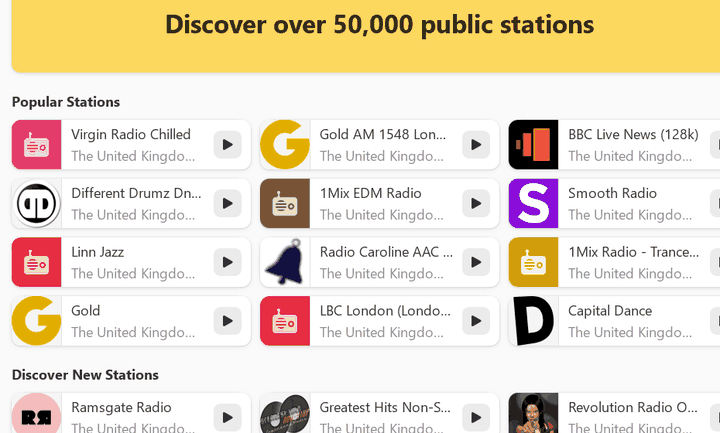
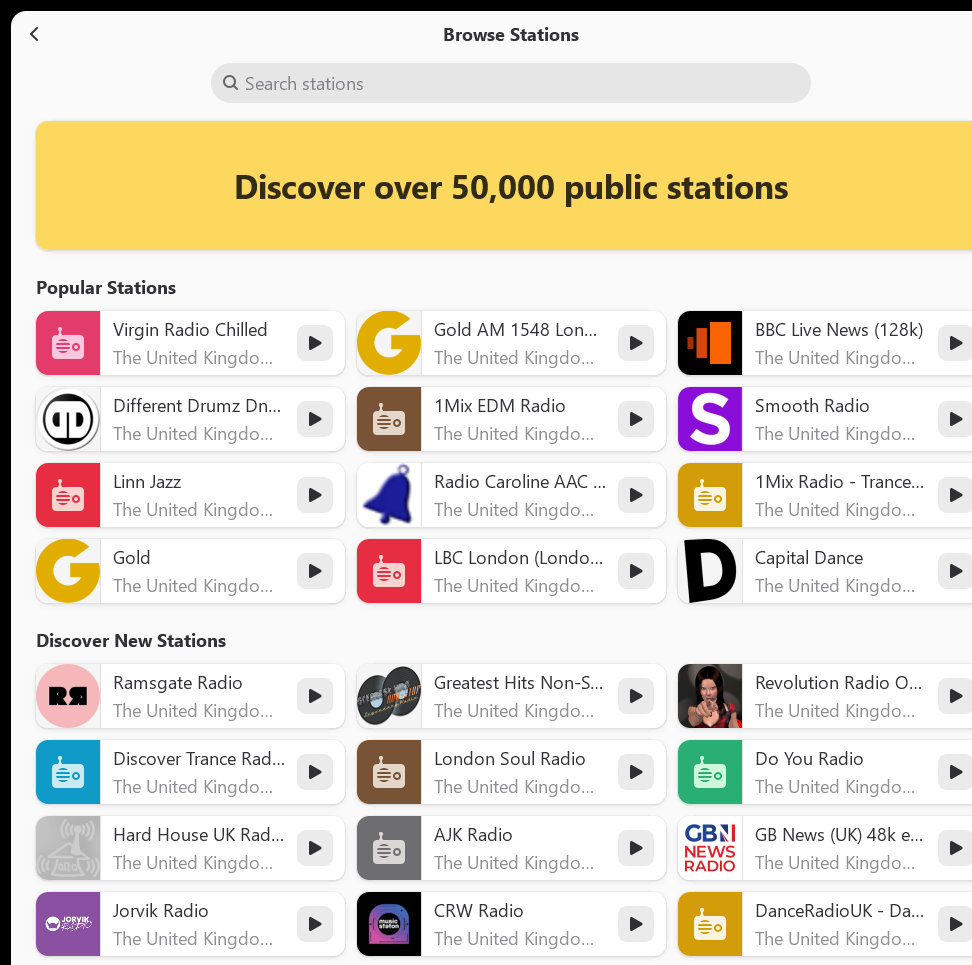
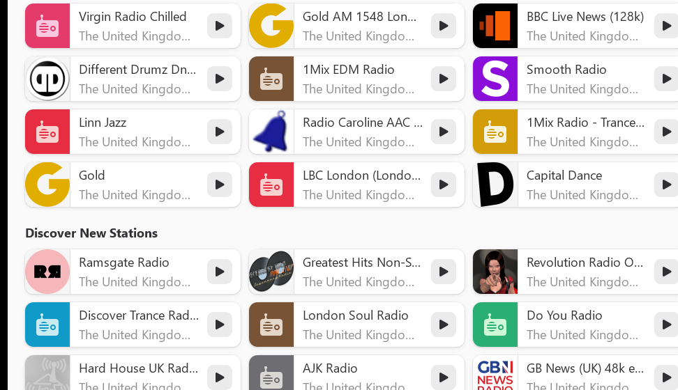

<div align="center">


# Shortwave for Windows

**Free internet radio player for Windows.** An unofficial Windows port of [Shortwave](https://apps.gnome.org/Shortwave/), the GNOME internet radio app by Felix Häcker and contributors.

[](https://github.com/postmanpat-303/shortwave/releases/latest)

[](https://github.com/postmanpat-303/shortwave/releases/latest) [](COPYING.md)  

[Website](https://postmanpat-303.github.io/shortwave/) · [Download](https://github.com/postmanpat-303/shortwave/releases/latest) · [Build guide](windows-packaging/README.md) · [Report a Windows problem](https://github.com/postmanpat-303/shortwave/issues)

</div>

> [!NOTE]
> This is an **unofficial** Windows build. It is not made, endorsed or supported by
> the Shortwave team or the GNOME Foundation. Please report Windows problems
> [here](https://github.com/postmanpat-303/shortwave/issues), not upstream.



## What it does

Shortwave is free, open-source software. There's no account, no ads and no subscription.

- **Over 50,000 stations** from the community database at [radio-browser.info](https://www.radio-browser.info/). Browse popular stations, discover new ones or search them all.
- **Your own library** of favourite stations. The last station you played is ready when you reopen the app.
- **Track recognition:** song titles are picked up from the stream, and you can save the tracks you like.
- **Three recording modes:** save every track, decide for each track, or record nothing. You choose the folder and the minimum and maximum length (up to 3 hours).
- **Adaptive layout** built with GTK 4 and Libadwaita, from a full window down to a narrow one, plus a wooden-radio mini player.
- **Keyboard shortcuts:** <kbd>Ctrl</kbd>+<kbd>F</kbd> search, <kbd>Ctrl</kbd>+<kbd>P</kbd> play/stop, <kbd>Ctrl</kbd>+<kbd>↑</kbd>/<kbd>↓</kbd> volume.

## Install

1. Download **`shortwave-<version>-win64-setup.exe`** from the [latest release](https://github.com/postmanpat-303/shortwave/releases/latest) (about 34 MB, 64-bit Windows).
2. Run it. The installer isn't code-signed, so if Windows SmartScreen appears, click **More info → Run anyway**.
3. Start Shortwave from the Start menu. The first launch can take a few seconds while the station list loads.

The SHA-256 of every installer is in its release notes. To check it in PowerShell: `Get-FileHash .\shortwave-5.1.0-win64-setup.exe`.

Silent install: `shortwave-5.1.0-win64-setup.exe /S /D=C:\full\path`. Uninstall from Windows Settings, or silently with `<install folder>\uninstall.exe /S`.

## Screenshots

| Browse stations (Windows) | Discover (Windows) |
|---|---|
|  |  |

Official Shortwave screenshots (from the Shortwave team, taken on Linux; the app looks the same on Windows):


## About this port

Shortwave's source code already supports Windows (for example the Windows media controls and platform-specific code paths). This repo adds **build and packaging only, with no changes to the app's code**:

- Built with MSYS2 (UCRT64): Rust, GTK 4, Libadwaita and GStreamer.
- Self-contained NSIS installer with everything included, a Start menu shortcut, an optional desktop shortcut and a normal uninstaller.
- Only the 23 GStreamer plugins Shortwave needs are shipped. MP3, AAC, FLAC, Vorbis, Ogg, WAV, AC3, MP4/M4A, HLS and MPEG-TS streams and recording were tested before release.
- The scripts and a step-by-step guide are in [`windows-packaging/`](windows-packaging/README.md), so anyone can rebuild it.

## FAQ

**Is it free?** Yes, completely. It's open source under the GPL-3.0-or-later.

**Is it official?** No. It's an unofficial Windows port by Del (postmanpat), built from the upstream Shortwave source.

**Where do the stations come from?** From [radio-browser.info](https://www.radio-browser.info/), a community database anyone can contribute to. Streams play straight from each station.

**Why does Windows warn me about the installer?** It isn't code-signed. Check the SHA-256 against the release notes, then click **More info → Run anyway**.

## Credits

**Shortwave** is created and maintained by **Felix Häcker**, with development by **Maximiliano Sandoval** and **Elias Projahn**, design by **Tobias Bernard**, translations by the [GNOME Translation Project](https://l10n.gnome.org/module/shortwave/) and code from [many contributors](https://gitlab.gnome.org/World/Shortwave/-/graphs/main). It's part of GNOME Circle.

- Official app: <https://apps.gnome.org/Shortwave/>
- Source code: <https://gitlab.gnome.org/World/Shortwave>
- Support Felix: <https://liberapay.com/haecker-felix>

The Windows build and packaging is by Del (postmanpat). If it's useful to you, you can [buy me a coffee](https://buymeacoffee.com/postmanpat) ☕.

## Licence

Shortwave is © Felix Häcker and contributors and is licensed under the
**GNU General Public License v3.0 or later**. See [COPYING.md](COPYING.md).
The Windows packaging in this repo is released under the same licence.
This port is not affiliated with the Shortwave project or the GNOME Foundation.
GNOME is a trademark of the GNOME Foundation.

---

## Original Shortwave README

*Everything below is the upstream Shortwave README, kept as it is. It describes
the official Linux version.*

Shortwave is an internet radio player that provides access to a station database with over 50,000 stations.

### Getting in Touch
If you have any questions regarding the use or development of Shortwave,
want to discuss design or simply hang out, please join us on our [#shortwave:gnome.org](https://matrix.to/#/#shortwave:gnome.org) matrix room.

### Installation

> *The instructions below are for the official Linux/Flatpak version from the
> Shortwave team. Windows users: use the
> [Windows installer](https://github.com/postmanpat-303/shortwave/releases/latest)
> from the top of this page instead.*

The recommended way of installing Shortwave is using the Flatpak package. If you don't have Flatpak installed yet, you can get it from [here](https://flatpak.org/setup/). You can install stable builds of Shortwave from Flathub by using this command:

`flatpak install https://flathub.org/repo/appstream/de.haeckerfelix.Shortwave.flatpakref`

Or by clicking this button:

<a href="https://flathub.org/apps/details/de.haeckerfelix.Shortwave"></a>

#### Nightly Builds

Development builds of Shortwave are available from the `gnome-nightly` Flatpak repository: 

```
flatpak remote-add --if-not-exists gnome-nightly https://nightly.gnome.org/gnome-nightly.flatpakrepo
flatpak install gnome-nightly de.haeckerfelix.Shortwave.Devel
```

### FAQ
- **Why is it called 'Shortwave'?**

    Shortwave signals have a very long range because of their very good reflection properties. 
Due to their long range, they can be received almost anywhere in the world. 
The same applies to Internet radio stations, which can also be received almost anywhere in the world.
That's why we decided to call the project 'Shortwave', because internet radio stations and shortwave radio stations share many characteristics.

    If you want to know more about the naming process, you should read this [blog post](https://blogs.gnome.org/tbernard/2019/04/26/naming-your-app/)

- **Why I cannot edit stations anymore?**

    The edit feature is disabled because of vandalism. I cannot change this. [More information here](http://www.radio-browser.info/gui/#/) and [here](https://github.com/segler-alex/radiobrowser-api/issues/39).

- **Is Shortwave compatible with Linux phones?**

    Yes! We use the awesome [libadwaita](https://gitlab.gnome.org/GNOME/libadwaita) library to make the interface adaptive. The easiest way to get it on your phone is using the Flatpak package. [Flathub](https://flathub.org/apps/details/de.haeckerfelix.Shortwave) provides aarch64 packages.


- **Which database does Shortwave use?**

    [radio-browser.info](http://www.radio-browser.info/gui/#/). It's a community database, everybody can contribute information.
    
- **How I can get debug information?**

    Run Shortwave using `RUST_BACKTRACE=1 RUST_LOG=shortwave=debug flatpak run de.haeckerfelix.Shortwave` (`.Devel`).

### Translations
Translation of this project takes place on the GNOME translation platform,
[Damned Lies](https://l10n.gnome.org/module/shortwave). For further
information on how to join a language team, or even to create one, please see
[GNOME Translation Project wiki page](https://wiki.gnome.org/TranslationProject).

### Building
#### Building with Flatpak + GNOME Builder
To build the development version of Shortwave and hack on the code see the
[general guide](https://welcome.gnome.org/app/Shortwave/#getting-the-app-to-build) for
building GNOME apps with Flatpak and GNOME Builder.

#### Building it manually
1. `git clone https://gitlab.gnome.org/World/Shortwave.git`
2. `cd Shortwave`
3. `meson --prefix=/usr build`
4. `ninja -C build`
5. `sudo ninja -C build install`

To learn more about the required dependencies, please check the [Flatpak manifest](build-aux/de.haeckerfelix.Shortwave.Devel.json).

### Code Of Conduct
We follow the [GNOME Code of Conduct](https://conduct.gnome.org/). All
communications in project spaces are expected to follow it.
